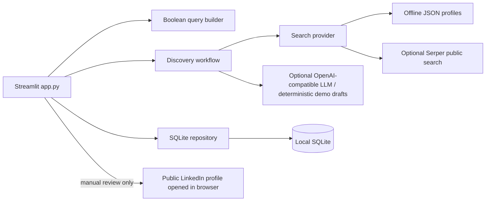

# code2career_ai Learner Discovery & Outreach

A small Streamlit MVP for the Technical Buddy & Growth Engineering Internship take-home. Run `app.py` for the complete single-process dashboard: discover synthetic profiles offline, create editable outreach drafts, and record only user-confirmed manual sends. Existing modular FastAPI/service files are retained, but the MVP does not require the API server. **Offline mode works without API credentials.**

> All profiles in `data/mock_profiles.json` and `sample_output.json` are synthetic fiction. Similarity to real people is coincidental. Live public X-Ray data may be stale, incomplete, or inaccurate and must be verified before outreach.

## Features

- Three Boolean X-Ray buckets: students/freshers, 1–2 YOE, and career switchers; optional keyword/location filters.
- Modular public-search provider interface (Serper) and JSON-backed offline mock provider.
- LinkedIn `/in/` URL validation, canonicalization and deduplication.
- Pydantic-validated persona, score and safe outreach fields; OpenAI-compatible JSON generation is optional.
- SQLite local history with discovery dedupe, separately counted handoffs, explicit manual-send confirmations, and a transactional timezone-aware daily cap (15 by default).
- One Streamlit dashboard for discovery, editing, history, and explicit retention clearing; SQLite repository and Pydantic validation are reused from the existing service modules.
- No LinkedIn page scraping, credentials/cookies, automatic sends, or automated interactions.

## Architecture



### Responsible-search / anti-ban architecture

Search calls go only to the configured third-party search provider and are made only after the user selects live mode and starts discovery. Search result URLs and fields are normalized and validated; the app never requests LinkedIn pages, attempts login, uses session cookies, evades access limits, or automates profile interactions. Provider quotas and terms apply. Offline mode does not make search or LLM requests. Human operators verify search data and manually send any message outside the app. This is a responsible-search boundary, not a guarantee that search providers or LinkedIn will return or index results.

### Deduplication and daily limits

SQLite stores one outreach record per canonical LinkedIn profile URL. Duplicate discoveries return as history and are not inserted as new targets. Handoff initiation is stored separately from a send confirmation. Only a user action with an explicit `confirmed=true` after manual sending creates a daily confirmed-send record. A `BEGIN IMMEDIATE` transaction checks the localized date count and inserts the confirmation atomically; uniqueness on `(profile_url, local_day)` prevents repeat confirmations inflating the count. The application timezone comes from `APP_TIMEZONE` (UTC by default). The daily cap defaults to 15 (`MAX_DAILY_SENDS`).

## Setup

Requires Python 3.11 or newer. Open a terminal in the project root.

### Windows (PowerShell)

```powershell
py -3.11 -m venv .venv
.\.venv\Scripts\Activate.ps1
python -m pip install -r requirements.txt
Copy-Item .env.example .env
```

### macOS / Linux

```bash
python3.11 -m venv .venv
source .venv/bin/activate
python -m pip install -r requirements.txt
cp .env.example .env
```

No values need to be added to `.env` for the offline demo. Set `OFFLINE_MODE_DEFAULT=true` to have the UI start in offline mode. SQLite is created locally at `data/outreach.sqlite3` and ignored by git.

### Optional live services

To use Serper, add a real `SERPER_API_KEY` and set `SEARCH_PROVIDER=serper`; choose the UI's offline toggle off to make live search calls. To use an OpenAI-compatible endpoint, set `OPENAI_API_KEY`, `OPENAI_API_BASE`, and `OPENAI_MODEL_NAME`. Never put keys in source, browser fields, screenshots, or commits. The app does not echo keys. Live search and model use are opt-in per discovery request; provider terms, fees and quotas apply. If LLM is enabled but unavailable/fails, the live discovery records a scoring error and does not silently substitute fabricated output.

## Run the MVP

From the project root, activate your virtual environment and run this single command:

```bash
streamlit run app.py
```

The dashboard opens at <http://localhost:8501>. No API server, credentials, or `.env` file is needed for the offline demo. Use the **Offline demo mode** toggle, choose one or more persona buckets, optionally enter a keyword/location, and click **Generate queries and discover profiles**. The app displays generated queries and local synthetic profiles. Drafts are editable; only clicking **Mark as manually sent** after sending the message yourself updates the send count. No message is sent by this application.

For optional live services, set `SERPER_API_KEY` and/or OpenAI-compatible variables in `.env` before starting the dashboard. Live public search is opt-in via the offline toggle. Without an LLM key, discovered profiles get deterministic, visibly marked demo drafts; provider errors do not masquerade as AI output.

The repository also retains an optional FastAPI service from the larger prototype, but the requested MVP path is the single Streamlit application above.

## Tests

```bash
python -m pytest -q
```

Tests use synthetic data and mocked clients. They do not make network requests or require provider credentials.

## Two-minute demo recording

1. Run `streamlit run app.py`; show the dashboard's local metrics and history.
2. Keep **Offline demo mode** on, select all three buckets, add `Python` and a location, then show generated Boolean queries and run discovery.
3. Point out the synthetic demo banner, persona/score evidence and uncertainty note; open a candidate's editable outreach, show character/word counts, copy the note, then open the public-profile link in a separate tab.
4. Record a handoff and explain it is not a send. Use the explicit confirmation only to demonstrate the manually-confirmed state; show the daily allowance and history status update.
5. Explain that live search and an optional LLM require server-side keys and are never called in offline mode.

## Limitations and security considerations

- Search indexing may be stale, incomplete, or incorrect; names/snippets can be ambiguous. Verify evidence and message content before use.
- Offline results and generated messages are synthetic demonstrations, not real contacts or AI outputs.
- Real search requires valid provider credentials; LLM generation requires an OpenAI-compatible service. Provider failures surface as errors, not fabricated payloads.
- The application stores profile snippets and outreach drafts locally in SQLite. Clear history from the dashboard or delete the local database file when no longer needed; database backups are not managed.
- There is no auth/multi-user model. The local API/UI are for a single trusted demonstrator; do not expose them to an untrusted network as-is.
- SQLite daily counting is transactional within this local deployment and uses the configured timezone. Do not treat user-confirmed records as independently verified sends.
- The app does not send messages, add connections, scrape LinkedIn, bypass platform restrictions, collect sensitive attributes, or guarantee career outcomes.
